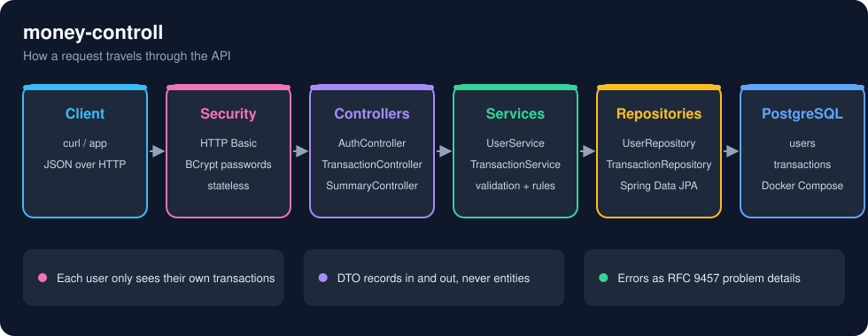
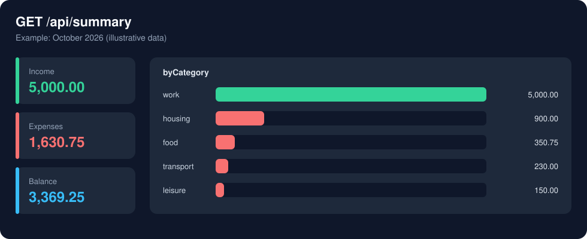

# money-controll

Personal finance REST API: register a user, record income and expenses, and get a summary of where the money went.

Built with Spring Boot 4, Spring Data JPA, Spring Security (HTTP Basic) and PostgreSQL.



## Features

- **Accounts**: register with a username and password (stored as a BCrypt hash); every other call uses HTTP Basic.
- **Transactions**: create, read, update and delete income and expenses, each with an amount, category and date.
- **Search**: filter by type, category and date range, sort by any field, and page through the results.
- **Summary**: total income, total expense, balance and a per-category breakdown for any period.
- **Isolation**: users only ever see their own data; someone else's transaction answers `404`.
- **Consistent errors**: errors are JSON problem documents, and validation errors name each bad field.

## Running

Requires Java 25 and Docker.

```bash
cd money-controll
./mvnw spring-boot:run
```

The PostgreSQL container in [compose.yaml](money-controll/compose.yaml) is started automatically and the API listens on `http://localhost:8080`.
Outside development, point the app at a database with `SPRING_DATASOURCE_URL`, `SPRING_DATASOURCE_USERNAME` and
`SPRING_DATASOURCE_PASSWORD`.

Tests run against an in-memory H2 database and need no Docker:

```bash
./mvnw test
```

## Endpoints

Everything except registration requires HTTP Basic authentication. Each user only sees their own transactions.

| Method | Path                     | Description                                 |
|--------|--------------------------|---------------------------------------------|
| POST   | `/api/auth/register`     | Create a user                               |
| GET    | `/api/auth/me`           | The authenticated user                      |
| GET    | `/api/transactions`      | List transactions (filtered, sorted, paged) |
| POST   | `/api/transactions`      | Create a transaction                        |
| GET    | `/api/transactions/{id}` | Get one transaction                         |
| PUT    | `/api/transactions/{id}` | Replace a transaction                       |
| DELETE | `/api/transactions/{id}` | Delete a transaction                        |
| GET    | `/api/summary`           | Income, expense and balance, per category   |

Query parameters:

- `GET /api/transactions`: `type` (`INCOME`/`EXPENSE`), `category`, `from`, `to` (`yyyy-MM-dd`, inclusive),
  `page`, `size` (max 100) and `sort` (e.g. `sort=amount,desc`; default `date,desc`).
- `GET /api/summary`: `from`, `to`. Defaults to the current month.

## Example

```bash
curl -X POST localhost:8080/api/auth/register -H 'Content-Type: application/json' \
  -d '{"username": "felipe", "password": "a-strong-password"}'

curl -u felipe:a-strong-password -X POST localhost:8080/api/transactions -H 'Content-Type: application/json' \
  -d '{"description": "Groceries", "amount": 350.75, "type": "EXPENSE", "category": "food", "date": "2026-10-03"}'

curl -u felipe:a-strong-password localhost:8080/api/summary
```

```json
{
  "from": "2026-10-01",
  "to": "2026-10-31",
  "totalIncome": 5000.00,
  "totalExpense": 350.75,
  "balance": 4649.25,
  "byCategory": [
    {"category": "work", "type": "INCOME", "total": 5000.00},
    {"category": "food", "type": "EXPENSE", "total": 350.75}
  ]
}
```

The same kind of response, drawn as a chart:



`date` is optional and defaults to today. Categories are free text, stored lower-case.

Errors are returned as [problem details](https://www.rfc-editor.org/rfc/rfc9457); validation errors include an
`errors` object keyed by field name.

A validation error looks like this:

```json
{
  "title": "Bad Request",
  "status": 400,
  "detail": "Validation failed",
  "instance": "/api/transactions",
  "errors": {
    "description": "must not be blank",
    "amount": "must be greater than 0"
  }
}
```

## Project layout

```
money-controll/src/main/java/com/projects/money_controll/
├── controller/   REST endpoints (auth, transactions, summary)
├── service/      business rules and validation
├── repository/   Spring Data JPA repositories
├── model/        JPA entities (User, Transaction)
├── dto/          request and response records
├── security/     HTTP Basic configuration and the authenticated principal
└── exception/    error responses
```

## Notes

- The schema is created by Hibernate (`ddl-auto=update`), which suits development; use migrations for real data.
- The database password in `compose.yaml` is a development placeholder.
- HTTP Basic sends credentials on every request, so serve the API over HTTPS outside localhost.
